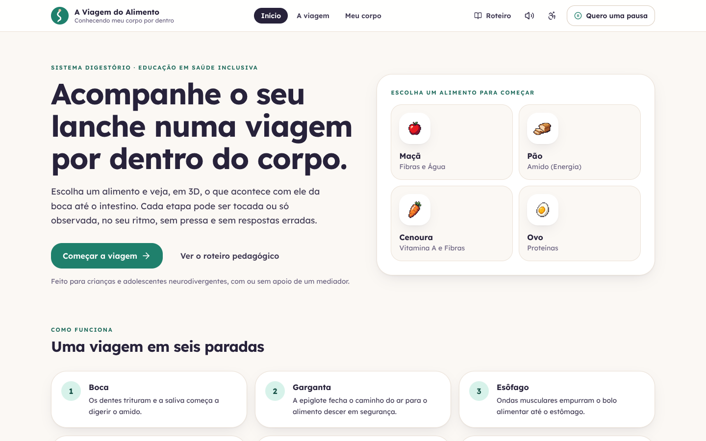
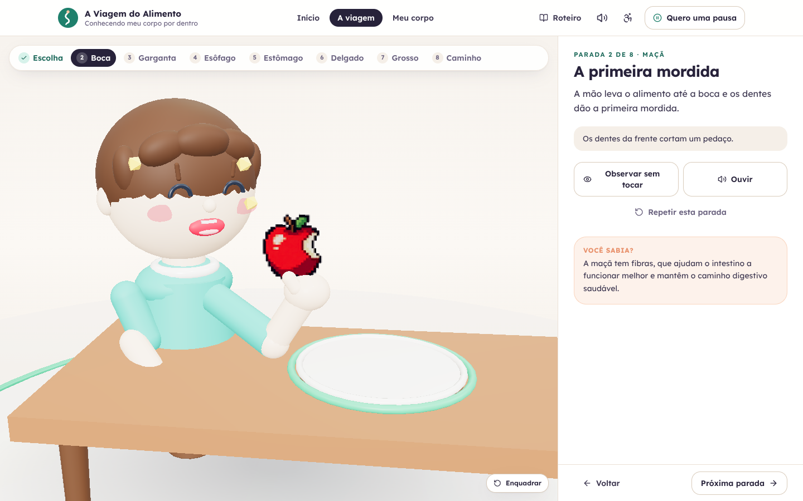

# A Viagem do Alimento

Experiência interativa em 3D sobre o sistema digestório, feita para crianças e adolescentes neurodivergentes (TEA, TDAH, TOC, dislexia e deficiência intelectual). A criança escolhe um alimento e acompanha o que acontece com ele da boca ao intestino grosso, parada por parada, tocando ou só observando, sem pressa e sem respostas erradas.

Projeto desenvolvido no âmbito do **BioDesign Inclusivo (FMU)**.

**Acesse:** https://enzorossi11.github.io/jogodebiomedicinaFINAL/



## A viagem

| Parada | O que acontece | O que a criança faz |
| --- | --- | --- |
| Escolha | Maçã, pão, cenoura ou ovo | Escolhe o alimento que vai viajar |
| Boca | A mão leva o alimento à boca; dentes trituram e a saliva umedece | Dá a mordida e mastiga cinco vezes |
| Garganta | A epiglote fecha o caminho do ar e guia o alimento | Engole e vê o alimento descer com segurança |
| Esôfago | Ondas musculares empurram o alimento para baixo | Aperta os três anéis, um por vez |
| Estômago | Sucos gástricos misturam tudo e formam o quimo | Pinga suco gástrico e enzimas |
| Intestino delgado | As vilosidades absorvem os nutrientes | Absorve energia, proteínas e vitaminas |
| Intestino grosso | A água volta para o corpo | Reabsorve as gotas de água |
| Caminho completo | O trajeto inteiro dentro do corpo | Monta a ordem dos cinco órgãos |



Cada parada traz um "Você sabia?" sobre o alimento escolhido e pode ser ouvida em narração calma (opcional).

Uma atividade complementar, **Meu corpo está falando comigo**, trabalha interocepção: a criança toca numa parte do corpo, reconhece uma sensação e diz do que precisa, com a opção "não sei" sempre disponível.

## Conforto sensorial

Regras que valem em toda a aplicação:

- **Sem som obrigatório.** Tudo funciona em silêncio; o áudio é opcional e desliga com um toque.
- **Sem luz piscante.** Cores calmas, movimentos lentos, nenhum flash.
- **Sem pressa.** Não há cronômetro. "Voltar" e "Próxima parada" nunca travam.
- **Sem certo ou errado.** Nenhuma resposta é punida; na montagem final, só o que está certo acende.
- **Observar sem tocar.** Toda parada pode ser assistida sem interagir.
- **Quero uma pausa.** Botão sempre visível que abre uma tela neutra de descanso.
- **Baixo estímulo e tamanho do texto** ajustáveis, guardados no navegador.

O detalhamento pedagógico está em [`docs/domain/business-rules.md`](docs/domain/business-rules.md), com glossário e personas na mesma pasta. O documento do projeto para mediadores fica em [`public/assets/docs/projeto-biodesign-fmu.pdf`](public/assets/docs/projeto-biodesign-fmu.pdf) e também abre pelo botão "Roteiro" dentro da aplicação.

## Como rodar

```bash
npm install
npm run dev
```

Outros comandos:

```bash
npm test          # testes (vitest)
npm run build     # verificação de tipos + build de produção em dist/
npm run preview   # serve o build localmente
```

A publicação no GitHub Pages é automática a cada push na branch `main` (`.github/workflows/deploy.yml`).

## Tecnologias

React 19, TypeScript, Vite, Tailwind CSS 4, Three.js (cena 3D com sprites 16-bit), Web Audio API (sons suaves) e Web Speech API (narração em pt-BR).

## Estrutura

```
src/
  App.tsx                   navegação entre capa, viagem e atividade complementar
  components/
    Capa.tsx                página inicial
    Cabecalho.tsx           cabeçalho, acessibilidade e pausa
    Jornada.tsx             a viagem: palco 3D + painel de cada parada
    Proposta2Interocepcao   atividade "Meu corpo está falando comigo"
    three/                  cena Three.js e as estações de cada órgão
  data/
    etapas.ts               ordem e nomes das paradas
    scriptData.ts           roteiro pedagógico e textos
  utils/audioSystem.ts      sons e narração
public/assets/              sprites, texturas e o PDF do projeto
docs/domain/                regras pedagógicas, glossário e personas
```

## Créditos

Projeto original de [Bsalvo/jogodebiomedicina](https://github.com/Bsalvo/jogodebiomedicina), evoluído nesta versão com nova interface, acessibilidade e publicação.
