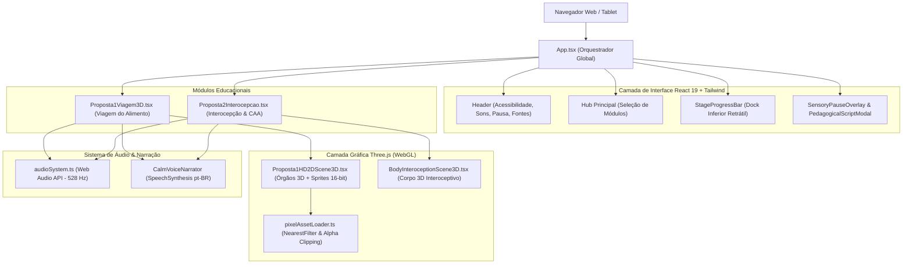

# Visão Geral do Sistema e Arquitetura Técnica (system-overview.md)

Este documento descreve a topologia arquitetural, os componentes de software e o ciclo de renderização entre o React e o Three.js.

---

## 1. Visão Geral da Stack

---

## 2. Padrão de Integração React 19 ↔ Three.js

A plataforma não utiliza wrappers que criam sobrecarga no React reconciler (como react-three-fiber antigo), mas sim controle direto em canvas dedicado através de hooks de efeito (`useEffect` / `useRef`):

1. **Ciclo de Vida do Canvas:**
   - Um elemento `<canvas ref={canvasRef} />` é montado pelo componente React.
   - O Three.js inicializa `WebGLRenderer`, `PerspectiveCamera`, `Scene` e `DirectionalLight` / `AmbientLight`.
   - Um loop `requestAnimationFrame` atualiza rotações suaves e movimentações de câmera amortecidas (`camera.position.lerp`).

2. **Gerenciamento de Memória e Prevenção de Leaks:**
   - Ao desmontar componentes ou trocar de estação anatômica, a função de limpeza do `useEffect` deve liberar formalmente:
     - `geometry.dispose()`
     - `material.dispose()`
     - `texture.dispose()`
     - `renderer.dispose()`
     - `renderer.forceContextLoss()`

3. **Renderização Estilo HD-2D:**
   - Sprites 2D são gerados e carregados via `pixelAssetLoader.ts`.
   - Texturas recebem `texture.magFilter = THREE.NearestFilter` e `texture.minFilter = THREE.NearestFilter` para preservar os pixels nítidos sem borramento bilinear.
   - O canal alfa é recortado automaticamente para remover fundos indesejados e integrar perfeitamente com os materiais 3D iluminados.

---

## 3. Acessibilidade Sensorial na Interface

- **Sem backdrop-filter em sobreposição:** A barra superior e os docks usam cores sólidas (`bg-white`, `bg-slate-900`) para evitar o peso do blur sobre GPUs integradas de tablets escolares.
- **Escalabilidade Tipográfica:** Controle de tamanho de texto dinâmico nas classes Tailwind (`text-sm`, `text-base`, `text-lg`), garantindo legibilidade para usuários com baixa visão ou dislexia.
